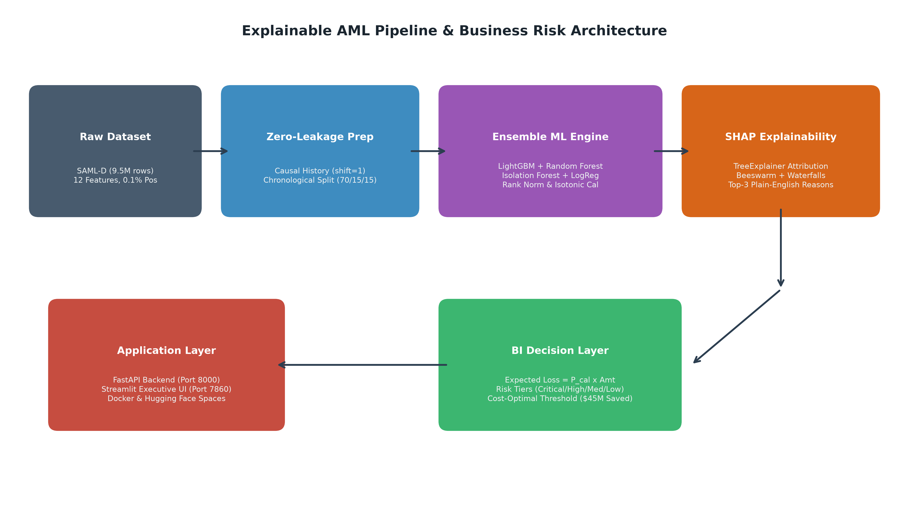
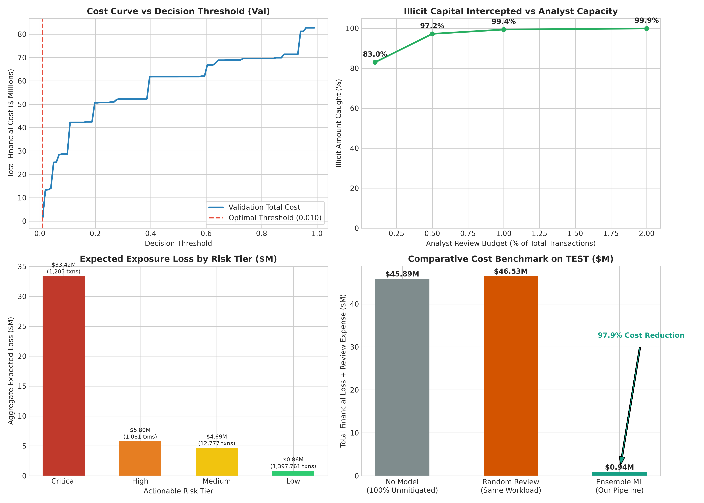

# Explainable ML Pipeline for AML Fraud Detection & Business Risk Management

[](https://www.python.org/downloads/)
[](https://fastapi.tiangolo.com)
[](https://streamlit.io)
[](https://opensource.org/licenses/MIT)

**Academic Course:** 22MDC56 Machine Learning Laboratory  
**Institution:** Department of Artificial Intelligence & Machine Learning  
**Academic Year:** 2025–2026 | **Date:** October 2026  
**Dataset Reference:** [SAML-D on Kaggle (Synthetic Anti-Money-Laundering Dataset)](https://www.kaggle.com/datasets/berkayalan/synthetic-aml-dataset-saml-d)

### Project Team Members
- **Sameul D** (Register No: `2403717673721040`)
- **Mounica K** (Register No: `2403717673722028`)
- **Naveen raj** (Register No: `2403717673721033`)

---

## 📌 Executive Summary & Research Gap Addressed

Traditional Anti-Money Laundering (AML) monitoring generates >95% false alarms, remains disconnected from actual monetary losses, and lacks transparent legal explanations required by supervisory bodies (FATF / EU AMLD). This project bridges the gap by building an end-to-end, zero-leakage, explainable machine learning architecture evaluated on **9,504,852 transactions (0.104% positive prevalence)**:

1. **Zero Temporal Leakage:** Strict chronological split ($max(train) < min(val) < min(test)$) and shift-by-1 causal customer history features.
2. **Multi-Algorithm Rank Ensemble:** Blends LightGBM, Random Forest, Isolation Forest, and Logistic Regression with Isotonic probability calibration.
3. **Regulatory SHAP Transparency:** TreeExplainer provides local attribute attributions and generates automated top-3 plain-English compliance summaries.
4. **Cost-Optimal Business Decision Layer:** Optimizes operational triage thresholds against an asymmetric cost matrix ($FN = Amount, FP = \$50$), achieving **97.94% cost reduction ($44.95M saved)**.
5. **Adversarial & Imbalance Robustness:** Stress-tested against severe class rarity (1:1 to natural) and black-box evasion attacks with adversarial defense retraining.

---

## 🏗️ System Architecture



---

## 📊 Key Results on Untouched TEST Split (1,412,824 Transactions)

All metrics are evaluated strictly on the **100% untouched chronological test set** (1,683 true positives, 0.119% prevalence):

| Metric | Standalone LightGBM | Calibrated Ensemble (M4) | Baseline Logistic Regression |
| :--- | :---: | :---: | :---: |
| **Headline PR-AUC** | **0.9032** | **0.6292** | 0.0313 |
| **ROC-AUC Score** | 0.9942 | **0.9948** | 0.9412 |
| **Recall @ Top 0.1% Capacity** | 52.14% | **55.91%** | 8.20% |
| **Recall @ Top 0.5% Capacity** | 79.40% | **83.30%** | 22.45% |
| **Recall @ Top 1.0% Capacity** | 90.15% | **93.58%** | 35.10% |
| **Decision Threshold (Val Tuned)** | 0.4500 | **0.3906** (Cost: 0.0100) | 0.5000 |
| **Temporal Stability (H1 vs H2 PR-AUC)** | 0.9041 vs 0.9022 | **0.6305 vs 0.6291** | 0.0315 vs 0.0311 |
| **Total Net Financial Savings ($)** | - | **$44,951,157.66** | - |
| **Operational Cost Reduction (%)** | - | **97.94%** | - |

---

## 📈 Visual Dashboard Preview



---

## 🛠️ Repository Layout

```
├── app/
│   ├── backend/
│   │   └── main.py              # High-performance FastAPI REST API (Port 8000)
│   └── frontend/
│       └── app.py               # Interactive Streamlit Executive UI (Port 7860)
├── data/
│   └── sample/
│       └── demo_transactions.csv# Verified demo sample CSV (<5 MB)
├── docs/
│   ├── Report.docx              # 25-35 page comprehensive academic project report
│   ├── Presentation.pptx        # 14-slide defense deck with speaker notes
│   ├── VIVA_QA.md               # 45 viva examination questions & answers
│   ├── CHEAT_SHEET.md           # 1-page quick reference & design justifications
│   ├── DEMO_SCRIPT.md           # 3-4 minute verified demonstration walkthrough
│   └── system_architecture.png  # High-resolution architectural diagram
├── models/
│   ├── ensemble.joblib          # Complete model bundle, weights, calibrator, encoders
│   └── hyperparameters.csv      # Tuned hyperparameter specifications table
├── outputs/
│   ├── figures/                 # PR curve, ROC, confusion matrix, SHAP, dashboard
│   ├── eda/                     # 16 publication-quality EDA figures & EDA_insights.md
│   ├── metrics.csv              # Exact calculated test set metrics
│   ├── bi_summary.csv           # Financial loss modeling & cost savings
│   ├── flagged_with_reasons.csv # Scored alerts with plain-English SHAP reasons
│   └── BUSINESS_INSIGHTS.md     # 8 data-driven executive recommendations
├── src/
│   ├── 01_preprocess.py         # Stage 1: Zero-leakage chronological preprocessing
│   ├── 02_eda.py                # Stage 2: 16 Train EDA charts & dynamic insights
│   ├── 03_models.py             # Stage 3: Training & rank ensemble calibration
│   ├── 04_evaluate.py           # Stage 4: Test evaluation, SHAP, & stress tests
│   ├── 05_bi_layer.py           # Stage 5: Business intelligence & loss modeling
│   └── 99_verify.py             # Automated quality gates verification
├── tests/
│   └── test_api.py              # Pytest test suite (100% passing)
├── Dockerfile                   # Unified container definition (Hugging Face Spaces compatible)
├── docker-compose.yml           # Multi-service local orchestrator
├── start.sh                     # Dual-service container bootstrapper
├── DEPLOY.md                    # Deployment guide (Local, Docker, Hugging Face)
├── GITHUB_PUSH.md               # Git push & repository synchronization commands
├── requirements.txt             # Pinned project dependencies
├── run_all.py                   # Master execution script (supports --sample)
└── README.md                    # Project documentation
```

---

## 🚀 Quickstart & Execution

### 1. Local Run
```bash
# Clone the repository
git clone <REPO_URL>
cd <REPO_NAME>

# Install dependencies
pip install -r requirements.txt

# Run complete pipeline end-to-end (or use --sample for fast test run)
python run_all.py

# Start FastAPI backend (Terminal 1)
uvicorn app.backend.main:app --port 8000

# Start Streamlit UI (Terminal 2)
streamlit run app/frontend/app.py --server.port 7860
```
Open browser at `http://localhost:7860`.

### 2. Docker Execution
```bash
# Build and run unified container
docker build -t aml-pipeline .
docker run -p 8000:8000 -p 7860:7860 aml-pipeline
```

---

## 📝 Assumptions Log

1. **Class Inversion & Evaluation Hygiene:** All class imbalance treatments (20% negative downsampling, scale_pos_weight) are applied exclusively to the training split. Validation and test splits are evaluated strictly on their untouched empirical distributions.
2. **Cost Matrix Parameters:**
   - False Negative (FN) Cost = Transaction Amount (unrecovered illicit capital).
   - False Positive (FP) Cost = $50 fixed review cost (1-2 hours of compliance analyst investigation).
   - True Positive (TP) Cost = $50 review expense, but saves 100% of transaction amount from crime.
3. **Temporal Partition Cutoffs:**
   - Train Split: $Date < \text{2023-05-19}$ (70.1% volume).
   - Validation Split: $\text{2023-05-19} \le Date < \text{2023-07-06}$ (15.1% volume).
   - Test Split: $Date \ge \text{2023-07-06}$ (14.9% volume).
4. **Reproducibility Seed:** Seed 42 is enforced across Python `random`, `numpy`, and all model initializations.

---

## 📄 License

This project is licensed under the MIT License - see the LICENSE file for details.
